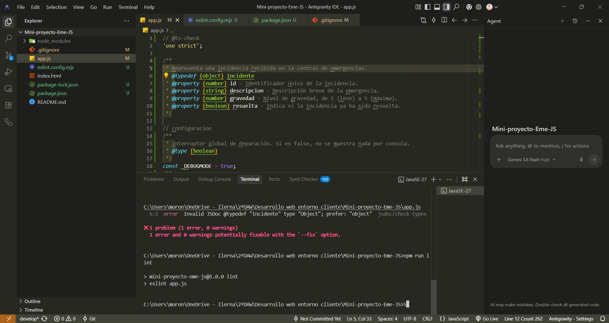
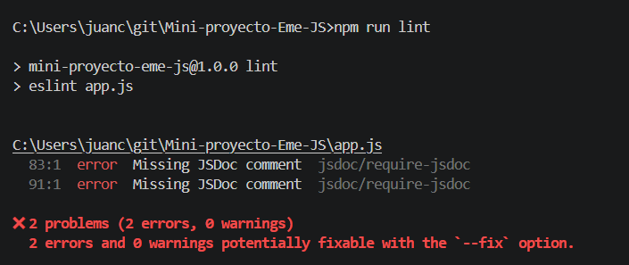
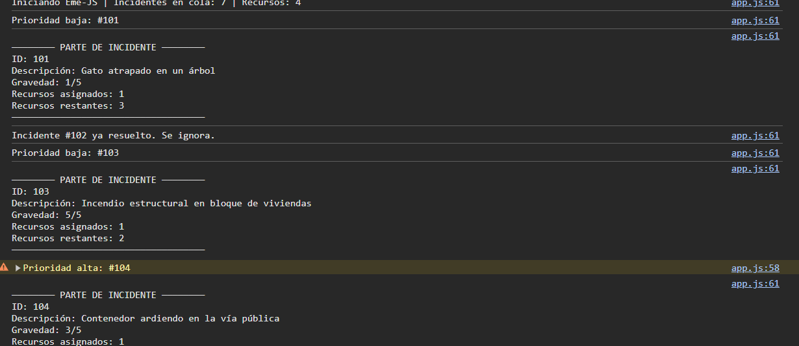
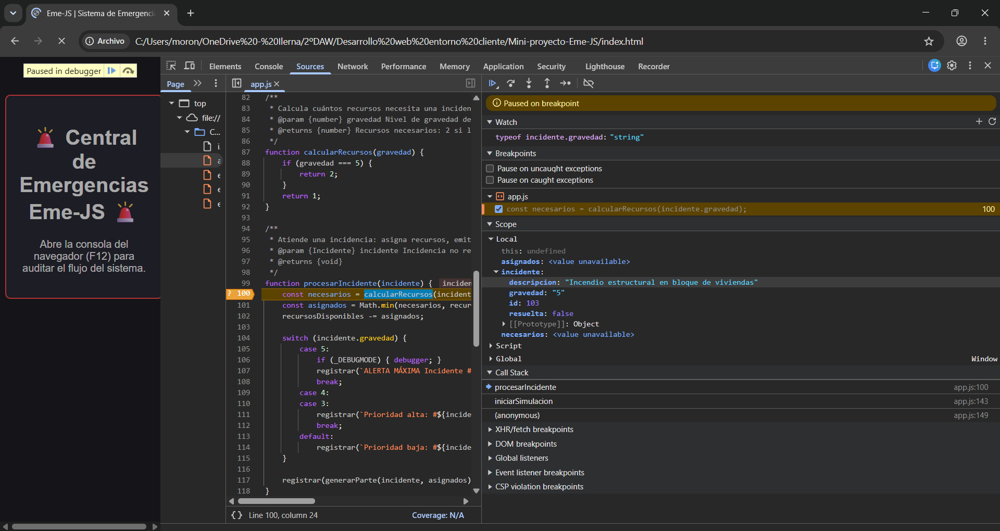

# 📔 Diario de Depuración y Co-Evaluación - Eme-JS

**Equipo:** Alvaro (Driver inicial) \& Juan Carlos (Navigator inicial)

🌐 **Pages:** https://moronlopezalvaro.github.io/Mini-proyecto-Eme-JS/

\---

### 🔍 Captura y Análisis de Variables (Debugger)

ESLint detecta {Object} en lugar de {object} en el @typedef; tras corregirlo, npm run lint pasa sin errores.

Al quitar bloques JSDoc, ESLint avisa de las funciones sin documentar (jsdoc/require-jsdoc).

El incendio estructural (#103) aparece como “Prioridad baja” y recibe 1 recurso en vez de 2.

Breakpoint condicional en incidente.id === 103. El Scope muestra gravedad: "5" y Watch confirma que su typeof es "string".

Para practicar la depuración, metimos un error a propósito: en la incidencia 103 escribimos
la gravedad como texto (`"5"`) en vez de como número (`5`). Por eso el incendio salía como
"Prioridad baja", recibía 1 recurso en vez de 2 y el sistema se paraba en la incidencia equivocada.
Para encontrarlo, pusimos un breakpoint condicional que solo paraba en la incidencia 103.
En el **Call Stack** vimos qué funciones se habían llamado hasta llegar ahí
(`iniciarSimulacion` → `procesarIncidente`), y en el **Scope** vimos que `gravedad` valía `"5"`
con comillas; en Watch, `typeof` confirmó que era un `string`. El fallo estaba en que `===`
no convierte tipos, así que `"5" === 5` da `false` y nunca entraba en el caso de gravedad 5.
Lo arreglamos poniendo el dato como número y convirtiéndolo con `Number()` por seguridad.

\---

### 👥 Experiencia de Pair Programming

Ha sido un trabajo entretenido de hacer, aunque también un poco tedioso, porque en un mismo
proyecto se juntan muchos conceptos y no los dominábamos todos.
Aun así, trabajar en pareja nos ha ayudado a sacarlo adelante, mientras uno escribía el código
el otro podía fijarse en los detalles que se escapan al teclear, como los tipos de datos. Alternar los roles de Driver y
Navigator nos obligó a explicarnos las cosas en voz alta, y eso nos ha servido para entenderlas un poco
mejor. También hemos aprendido a organizarnos con Git (hacer pull antes de empezar, commitear
al cambiar de rol y trabajar en develop antes de mergear con main), y al principio se nos
olvidaba indicar los roles en los mensajes de commit. En general, el proyecto nos ha servido
para funcionar mejor como equipo y para ver cómo se trabaja en un entorno más parecido al real.

